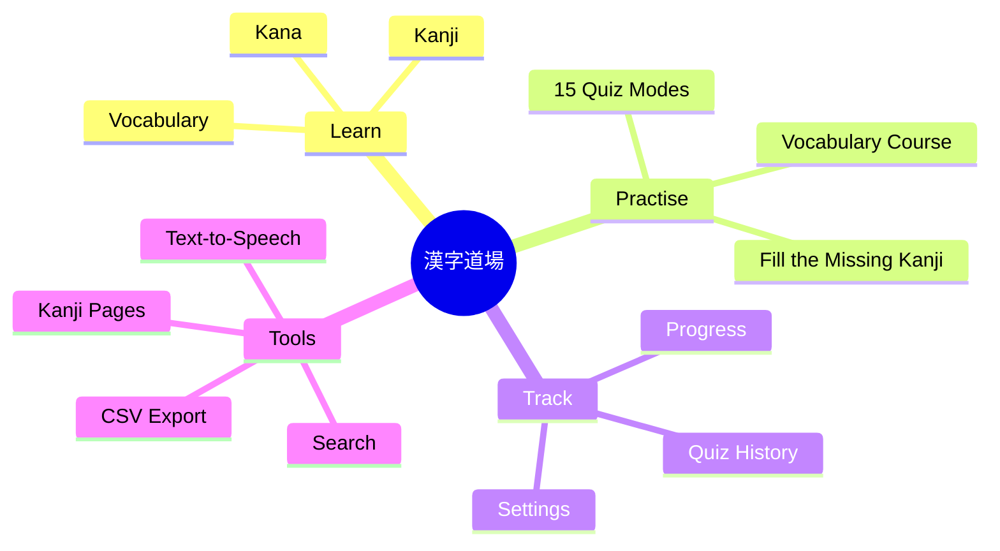
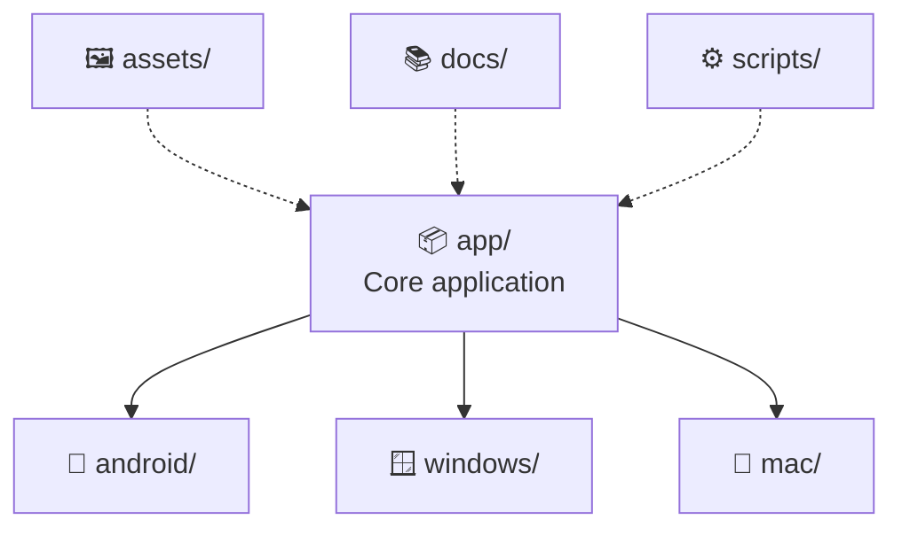

### A Cross-Platform Japanese JLPT N5 Learning Application

 

<!-- Row 1: project identity -->

  
  
  
  

<!-- Row 2: platforms -->

  
  
  
  

<!-- Row 3: live repository stats -->

  
  
  
  

<!-- Row 4: release & activity -->

  
  
  
  

 

&nbsp;

  

  <a href="#-about-the-project">About</a> ·
  <a href="#-features--capabilities">Features</a> ·
  <a href="#-application-preview">Preview</a> ·
  <a href="#-download--installation">Download</a> ·
  <a href="#%EF%B8%8F-technology--development">Development</a> ·
  <a href="#-documentation">Docs</a> ·
  <a href="#-support-the-project">Support</a>

---

## ✨ About the Project

**N5 Kanji Dojo** is a cross-platform Japanese learning application developed by **Ayush Kumar**, designed to help learners prepare for the **Japanese Language Proficiency Test (JLPT N5)**.

The application combines structured learning, interactive quizzes, kanji recognition, vocabulary practice, pronunciation support, and progress tracking in one study environment.

Whether you're beginning your Japanese journey or strengthening your N5 foundation, Kanji Dojo provides tools to make daily practice more engaging.

### 🎯 Learning Philosophy

> **Learn consistently. Recognize patterns. Practise actively. Master Japanese step by step.**

---

## 📊 At a Glance

| 🈶 | 🧠 | 🖥️ | 📴 |
|:---:|:---:|:---:|:---:|
| **JLPT N5** Focused syllabus | **15** Reported quiz modes | **4** Platform builds | **Offline** First design |

Figures are taken from the supplied project handover notes.

---

## 🔁 How Learning Works

---

## 🚀 Features & Capabilities

<table>
<tr>
<td width="50%" valign="top">

### 🈶 Japanese Learning
- JLPT N5 kanji practice
- Vocabulary learning
- Kana practice
- Kanji recognition
- Japanese pronunciation

</td>
<td width="50%" valign="top">

### 🧠 Interactive Practice
- 15 reported quiz modes
- Vocabulary Course
- Fill the Missing Kanji
- Active recall exercises
- Knowledge reinforcement

</td>
</tr>
<tr>
<td width="50%" valign="top">

### 📊 Learning Management
- Learning progress tracking
- Quiz history
- Persistent settings
- Locally saved custom vocabulary
- CSV vocabulary export

</td>
<td width="50%" valign="top">

### ⚙️ Application Experience
- Mobile and desktop layouts
- Search functionality
- Individual kanji pages
- Operating-system text-to-speech
- Offline-first design

</td>
</tr>
</table>

Features are transcribed from the supplied project handover. Availability may vary between platform versions.

---

## 🖥️ Platform Compatibility

| Platform | Release | Distribution |
|:---:|:---:|:---:|
| 🤖 **Android** | `v1.6` | APK |
| 🪟 **Windows** | `v1.6` | Setup EXE |
| 🍎 **macOS Apple Silicon** | `v1.5` | ZIP |
| 💻 **macOS Intel** | `v1.5` | ZIP |

Release information is based on supplied project handover notes. Verify each binary and build before publishing a release.

---

## 📸 Application Preview

<!-- Add your actual screenshots to assets/screenshots/ -->

<table>
<tr>
<td align="center" width="50%">
 
<b>🏠 Home Screen</b>
</td>
<td align="center" width="50%">
 
<b>📖 Learning Interface</b>
</td>
</tr>
<tr>
<td align="center" width="50%">
 
<b>🈶 Kanji Practice</b>
</td>
<td align="center" width="50%">
 
<b>🧠 Quiz Interface</b>
</td>
</tr>
</table>

> Add the actual application screenshots to `assets/screenshots/` using the filenames shown above. Until then, these preview images will appear as placeholders.

---

## 📥 Download & Installation

| Platform | Expected release asset |
|:---:|:---|
| 🤖 Android | `N5-Kanji-Dojo-v1.6.apk` |
| 🪟 Windows | `N5-Kanji-Dojo-Setup-v1.6.exe` |
| 🍎 macOS Apple Silicon | `N5-Kanji-Dojo-v1.5-mac-AppleSilicon.zip` |
| 💻 macOS Intel | `N5-Kanji-Dojo-v1.5-mac-Intel.zip` |

> **Important:** These are expected filenames, not verified download links. The actual binary packages must be uploaded to GitHub Releases before downloads are available.

### 📘 Installation Guides

---

## 🛠️ Technology & Development

The repository is intended to contain the original application source and platform-specific project files.

| Component | Purpose |
|:---|:---|
| `app/` | Core application |
| `android/` | Android application source |
| `windows/` | Windows application source |
| `mac/` | macOS application source |
| `assets/` | Images and application resources |
| `docs/` | Technical and installation documentation |
| `scripts/` | Build and release automation |

Confirm the actual source tree and technology stack against the checked-in files. This describes intended repository organization, not a verified dependency inventory.

---

## 📚 Documentation

| 📄 Document | 📝 Description |
|:---|:---|
| [VERSIONS.md](VERSIONS.md) | Platform version information |
| [CHANGELOG.md](CHANGELOG.md) | Release history |
| [ARCHITECTURE.md](docs/ARCHITECTURE.md) | Application architecture |
| [BUILD_ANDROID.md](docs/BUILD_ANDROID.md) | Android build instructions |
| [BUILD_WINDOWS.md](docs/BUILD_WINDOWS.md) | Windows build instructions |
| [BUILD_MACOS.md](docs/BUILD_MACOS.md) | macOS build instructions |
| [RELEASE_PROCESS.md](docs/RELEASE_PROCESS.md) | Release preparation |
| [AUDIO_SETUP.md](docs/AUDIO_SETUP.md) | Japanese speech configuration |
| [FAQ.md](docs/FAQ.md) | Frequently asked questions |
| [SECURITY.md](SECURITY.md) | Security policy |
| [PRIVACY.md](PRIVACY.md) | Privacy statement |
| [THIRD_PARTY_NOTICES.md](THIRD_PARTY_NOTICES.md) | Third-party attribution |

---

## 🎬 Demo

<!-- Replace with your GIF once uploaded -->

A demonstration video can be added at `demo/Demo-Kanji-Dojo.mp4`, and a GIF preview at `assets/demo/kanji-dojo-demo.gif`. See [demo/README.md](demo/README.md) for instructions.

---

## 🔊 Japanese Pronunciation

Japanese pronunciation uses text-to-speech provided by the host operating system. Voice availability depends on installed Japanese language and speech packages.

---

## 🧑‍💻 Developer

### Built with dedication by **Ayush Kumar**

**Japanese Language Learning · Application Development · Cross-Platform Software**

  

---

## 🔐 Security & Privacy

- Review [SECURITY.md](SECURITY.md) for vulnerability reporting.
- Review [PRIVACY.md](PRIVACY.md) for privacy information.
- Do not commit signing keys, passwords, API tokens, or private credentials.
- Verify third-party dependencies and distribution permissions before releasing binaries.

---

## 📜 License

See [LICENSE](LICENSE). The current repository license reserves rights and does not grant general redistribution or modification permissions. Confirm ownership and third-party licensing obligations before changing it.

---

## ⭐ Support the Project

| ⭐ Star | 🍴 Fork | 🐛 Report | 💡 Suggest | 📢 Share |
|:---:|:---:|:---:|:---:|:---:|
| Star this repository | Fork for experimentation | Report issues and bugs | Suggest improvements | Tell Japanese learners |

 

**Every bit of support helps the project grow!**

---

### 日本語を学ぼう！ 🇯🇵

**Learn Japanese. Practise Every Day. Keep Improving.**

© Ayush Kumar · N5 Kanji Dojo

