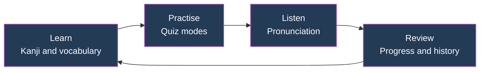

 

**A cross-platform application for JLPT N5 kanji, vocabulary, and pronunciation practice.**

 

  
  
  
  
  

  
  
  
  
  

  <a href="#overview">Overview</a> &nbsp;·&nbsp;
  <a href="#features">Features</a> &nbsp;·&nbsp;
  <a href="#platform-support">Platforms</a> &nbsp;·&nbsp;
  <a href="#installation">Installation</a> &nbsp;·&nbsp;
  <a href="#repository-structure">Structure</a> &nbsp;·&nbsp;
  <a href="#documentation">Documentation</a> &nbsp;·&nbsp;
  <a href="#contributing">Contributing</a>

---

## Overview

N5 Kanji Dojo is a cross-platform Japanese learning application developed by **Ayush Kumar** to support preparation for the **Japanese Language Proficiency Test (JLPT) N5**.

It brings structured learning, interactive quizzes, kanji recognition, vocabulary practice, pronunciation support, and progress tracking together in a single study environment designed for consistent daily practice.

| JLPT N5 | 15 | 4 | Offline |
|:---:|:---:|:---:|:---:|
| Focused syllabus | Reported quiz modes | Platform builds | First design |

Figures are drawn from the project handover notes.

### Study Workflow

---

## Features

<table>
<tr>
<td width="50%" valign="top">

**Japanese Learning**
- JLPT N5 kanji practice
- Vocabulary learning
- Kana practice
- Kanji recognition
- Japanese pronunciation

</td>
<td width="50%" valign="top">

**Interactive Practice**
- 15 reported quiz modes
- Vocabulary Course
- Fill the Missing Kanji
- Active recall exercises
- Knowledge reinforcement

</td>
</tr>
<tr>
<td width="50%" valign="top">

**Learning Management**
- Learning progress tracking
- Quiz history
- Persistent settings
- Locally saved custom vocabulary
- CSV vocabulary export

</td>
<td width="50%" valign="top">

**Application Experience**
- Mobile and desktop layouts
- Search functionality
- Individual kanji pages
- Operating-system text-to-speech
- Offline-first design

</td>
</tr>
</table>

Features are transcribed from the project handover. Availability may vary between platform versions.

---

## Screenshots

<!-- Add screenshots to assets/screenshots/ using the filenames below. -->

<table>
<tr>
<td align="center" width="50%">
 
<b>Home</b>
</td>
<td align="center" width="50%">
 
<b>Learning</b>
</td>
</tr>
<tr>
<td align="center" width="50%">
 
<b>Kanji Practice</b>
</td>
<td align="center" width="50%">
 
<b>Quiz</b>
</td>
</tr>
</table>

> Screenshots will display once the image files are added to `assets/screenshots/`.

---

## Platform Support

| Platform | Version | Distribution |
|:---|:---:|:---:|
| Android | 1.6 | APK |
| Windows | 1.6 | Setup EXE |
| macOS (Apple Silicon) | 1.5 | ZIP |
| macOS (Intel) | 1.5 | ZIP |

Version information is based on the project handover notes. Verify each binary and build before publishing a release.

---

## Installation

Download the latest build from the [GitHub Releases](https://github.com/ayush13-0/N5-Kanji-Dojo/releases) page.

| Platform | Expected release asset | Guide |
|:---|:---|:---:|
| Android | `N5-Kanji-Dojo-v1.6.apk` | [Install](docs/INSTALL_ANDROID.md) |
| Windows | `N5-Kanji-Dojo-Setup-v1.6.exe` | [Install](docs/INSTALL_WINDOWS.md) |
| macOS (Apple Silicon) | `N5-Kanji-Dojo-v1.5-mac-AppleSilicon.zip` | [Install](docs/INSTALL_MACOS.md) |
| macOS (Intel) | `N5-Kanji-Dojo-v1.5-mac-Intel.zip` | [Install](docs/INSTALL_MACOS.md) |

> **Note:** Filenames above are expected names, not verified download links. Binary packages must be uploaded to GitHub Releases before downloads are available.

### Japanese Pronunciation

Pronunciation uses text-to-speech provided by the host operating system. Voice availability depends on the installed Japanese language and speech packages. See the [Audio Setup guide](docs/AUDIO_SETUP.md) for configuration and troubleshooting.

---

## Repository Structure

The repository is intended to contain the application source and platform-specific project files.

| Directory | Purpose |
|:---|:---|
| `app/` | Core application |
| `android/` | Android application source |
| `windows/` | Windows application source |
| `mac/` | macOS application source |
| `assets/` | Images and application resources |
| `docs/` | Technical and installation documentation |
| `scripts/` | Build and release automation |

Confirm the source tree and technology stack against the checked-in files. This table describes intended organization, not a verified dependency inventory.

---

## Documentation

| Document | Description |
|:---|:---|
| [VERSIONS.md](VERSIONS.md) | Platform version information |
| [CHANGELOG.md](CHANGELOG.md) | Release history |
| [ARCHITECTURE.md](docs/ARCHITECTURE.md) | Application architecture |
| [BUILD_ANDROID.md](docs/BUILD_ANDROID.md) | Android build instructions |
| [BUILD_WINDOWS.md](docs/BUILD_WINDOWS.md) | Windows build instructions |
| [BUILD_MACOS.md](docs/BUILD_MACOS.md) | macOS build instructions |
| [RELEASE_PROCESS.md](docs/RELEASE_PROCESS.md) | Release preparation |
| [AUDIO_SETUP.md](docs/AUDIO_SETUP.md) | Japanese speech configuration |
| [FAQ.md](docs/FAQ.md) | Frequently asked questions |
| [SECURITY.md](SECURITY.md) | Security policy |
| [PRIVACY.md](PRIVACY.md) | Privacy statement |
| [THIRD_PARTY_NOTICES.md](THIRD_PARTY_NOTICES.md) | Third-party attribution |

---

## Demo

A demonstration video can be placed at `demo/Demo-Kanji-Dojo.mp4`, with a GIF preview at `assets/demo/kanji-dojo-demo.gif`. See [demo/README.md](demo/README.md) for instructions.

---

## Contributing

Feedback is welcome.

- **Report a bug:** open an [issue](https://github.com/ayush13-0/N5-Kanji-Dojo/issues).
- **Suggest an improvement:** open an issue describing the use case.
- **Support the project:** star the repository and share it with Japanese learners.

---

## Security and Privacy

- Report vulnerabilities as described in [SECURITY.md](SECURITY.md).
- Data handling is described in [PRIVACY.md](PRIVACY.md).
- Do not commit signing keys, passwords, API tokens, or private credentials.
- Verify third-party dependencies and distribution permissions before releasing binaries.

---

## License

See [LICENSE](LICENSE). The current repository license reserves all rights and does not grant general redistribution or modification permissions. Confirm ownership and third-party licensing obligations before changing it.

---

**Developed by Ayush Kumar**

© Ayush Kumar · N5 Kanji Dojo

